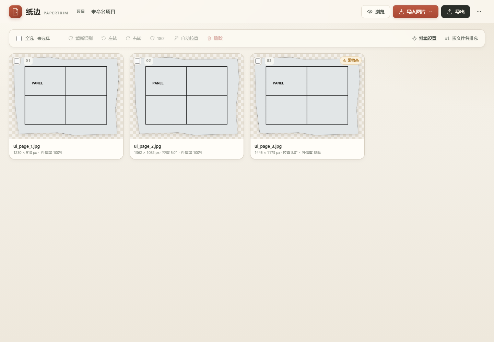
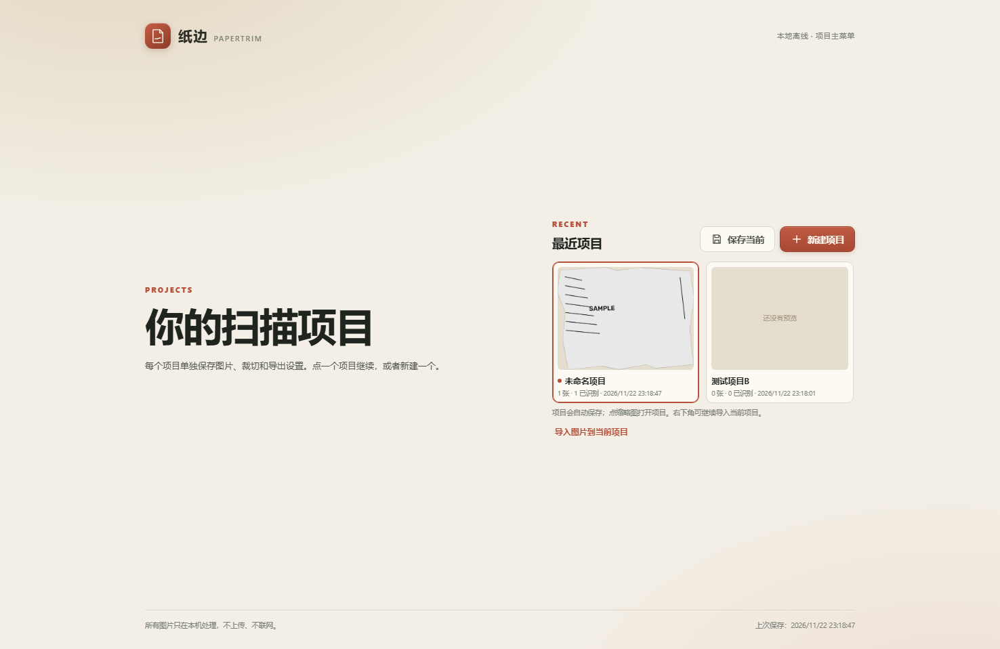
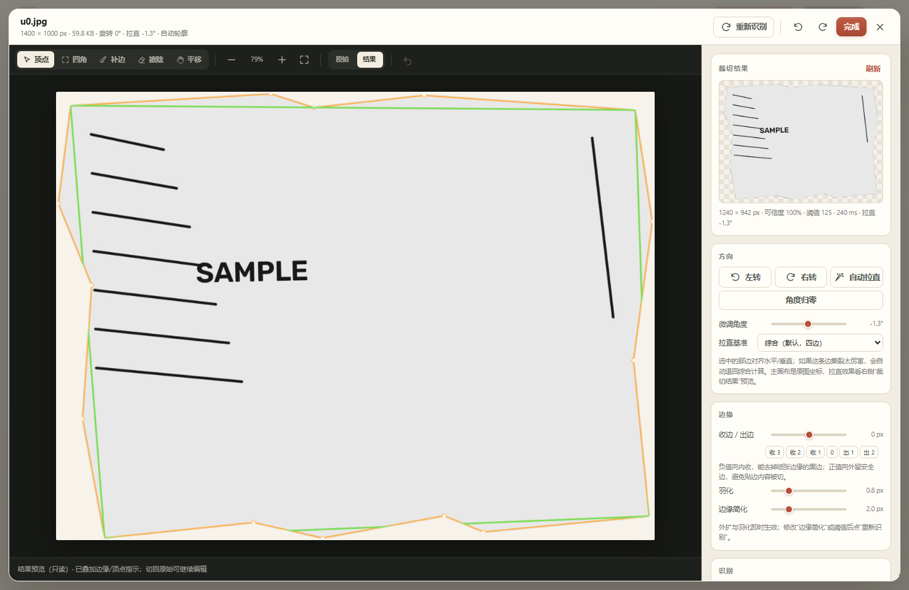
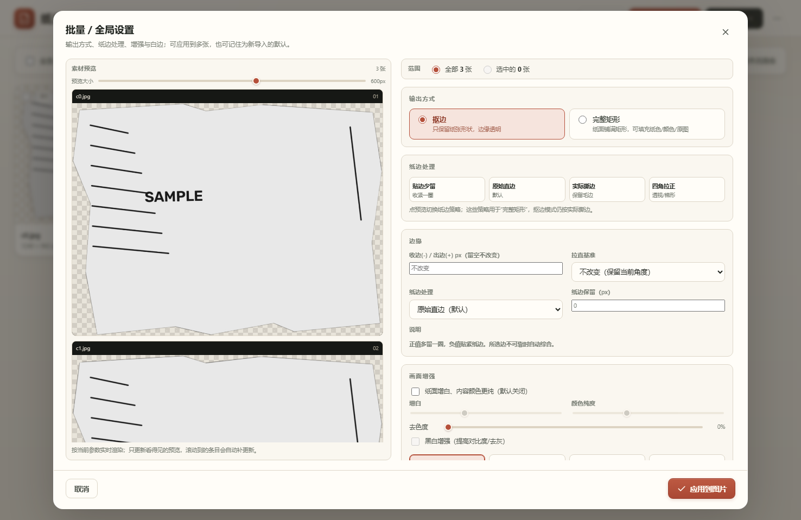
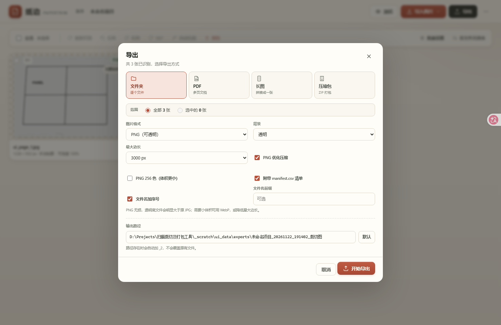
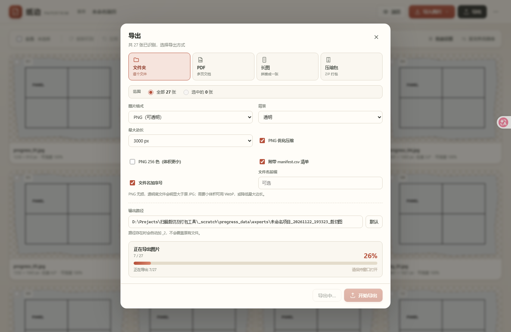

# 纸边 PaperTrim

> 把拍歪、撕破、带缺口的扫描纸片，沿真实边缘裁到正好，再一次性导出。
> 完全离线运行，不上传图片，没有遥测。

## 作者与说明

- 作者：**DeepSeek（大肥鱼）**、**金钻**
- 本项目代码由 AI 完成；人工负责需求确认、功能测试、验收与发布。





## 它解决什么问题

手机拍扫描件或翻拍手稿时，纸张经常是斜的，边缘有撕裂、卷边、缺口，背景还会留下阴影。普通的“按矩形裁切”会切掉边缘内容，或者把大片背景带进结果。

PaperTrim 会：

1. 找出纸张与背景的真实边界；
2. 沿着撕裂、缺口、卷边的轮廓生成裁切蒙版，而不是简单套一个矩形；
3. 从长直线（分格线、文字基线）估计倾斜角，自动拉直；旋转能摆正时只旋转，遇到梯形/透视时才用四角拉伸；
4. 让你逐张检查、批量旋转、重新识别、手动拖顶点/补边/擦除，也可以批量设置输出方式；
5. 全部确认后，批量导出为文件夹、PDF、长图或 ZIP。





## 功能

### 识别与裁切

- 自动识别纸张区域，保留不规则边缘；收边/出边、羽化可调。
- 对闭合的分格线、深色边框做了处理，不会把一格漫画误认成整张纸。
- 手绘的分格框/绿色边框只当内容线；纸张外圈的留白（即使被画框隔开）会合并回纸面，不会被当成纸边切掉。
- 边界撕裂、缺口会保留；可开启“内部扣洞”，把纸张内部的大块缺口也挖成透明（默认关闭，避免把实心黑色画稿误当洞）。
- **原始纸边重建**（默认开启）：按“损坏以内侵为主、局部会崩开”的规律，用稳健长边拟合还原纸张四边；可选原始直边/实际撕边/四角拉正，并可用“纸边保留”px 多留或少留。
- **批量/全局设置**左侧直接列出当前项目的素材预览（按选中顺序竖排），预览大小可拖动调节，默认比旧版大；点预览可全屏放大查看。
- 参数调整时只重渲染**当前看得见**的预览，滚动到下方才补更新，图片多时不会被全部重算拖慢。
- **去色度**滑块控制从原色到黑白的程度（0–100%），另有“黑白增强”复选提升对比度/去灰。
- 单图编辑顶部有 **原始 / 结果** 开关：默认原始图并显示边缘线、顶点等指示；切到结果就是按当前参数计算完成的所见即所得画面，指示线也叠加在结果上。
- 自动拉直：从画面中的长直线和纸张轮廓长边一起估计角度；轮廓方向用长边加权，避免被撕裂的缺角带偏。重新识别后会自动重新拉直。
- **拉直基准**：可选综合（默认，四边一起算）/上边/下边/左边/右边。选某一边时优先让那条边水平或垂直；如果该边撕裂/卷曲太厉害，会自动退回综合计算。顶边或角部有崩开时，综合通常比单看顶边稳。
- **画面增强**：可选把纸面增白、让内容颜色更纯（白平衡 + 轻度色阶/饱和度）；默认关闭，只影响预览和导出，不改原图。
- 手动纠偏：微调角度滑杆、角度归零、重新识别。
- 轮廓点数可以由用户增加或减少；开启“钢笔曲线”后，边线会平滑通过控制点，适合修出圆滑的纸边。
- 收边负值可以去掉纸张边缘的 1–3 px 黑边；正值给贴边内容留安全边。

### 完整矩形 / 透视校正

- 每张图可以选择 **抠边** 或 **完整矩形**。
- 完整矩形自动判断：旋转就能摆正时只旋转，不拉伸；梯形/透视明显时才使用四角透视。
- 四角会自动检测，也可以在单张编辑器里切换到“四角”模式拖动确认。
- 输出比例默认按纸片四边估算；也可以指定宽:高。
- 可统一设置白边范围（px），并选择填充：纸色、自定义颜色、白色、透明、原图原样（不抠像）。
- 批量设置一次应用到全部或选中图片，并可记住为以后导入的默认。

### 审阅

- 网格视图显示全部裁切结果，透明边缘用棋盘格显示。
- 全屏浏览，左右切换。
- 批量选择：左转 / 右转 / 180° / 自动拉直 / 重新识别 / 删除。
- 单张编辑器：
  - 拖动顶点、点击边线新增顶点、右键删除顶点；
  - “补边”“擦除”笔刷，修复漏掉的纸边或多余的背景；
  - 撤销（Ctrl+Z）；
  - 旋转 90°、微调角度、外扩/羽化、阈值/反相/边缘简化；
  - 修改自动保存，结果预览实时更新。

### 导出

全部检查完成后，可以导出：

| 方式 | 说明 |
|---|---|
| 文件夹 | 每张一个文件，支持 PNG / JPG / WebP，透明或指定背景，可附 `manifest.csv` |
| PDF | 多页文档，A4 / A3 / Letter / 跟随图片，页边距、方向、DPI、质量可调 |
| 长图 | 纵向或横向拼接，统一宽度/高度、间距、背景、格式可调 |
| ZIP | 按指定图片格式打包，可附清单 |

- **透明底默认开启**：文件夹和 ZIP 默认 PNG + 透明；JPG 不支持透明时会自动换成白色。
- **质量/体积可调**：JPG/WebP 有质量滑杆；PNG 有优化压缩和 256 色选项；可限制最大边长（默认 3000 px）来控制文件大小。
- **PNG 无损但体积大**：2 MB 的 JPG 扫描导出为 10 MB 的透明 PNG 是正常的；需要小文件时改用 WebP、降低最大边长或勾选 PNG 256 色。
- **项目主菜单**：顶部房子按钮列出最近项目（带封面/图片数/更新时间），可以新建、打开、保存并继续；每个项目独立保存图片、裁切和导出设置。
- 导出按钮是下拉菜单，和导入一致，可直接选文件夹 / PDF / 长图 / ZIP 后再配置。
- **导出进度条**：显示当前数量/总数、百分比和当前阶段（排版、拼接、写入清单等）；完成后停在 100%。
- **性能**：导入识别和文件夹/ZIP 导出使用多线程；启动时自动设置 OpenCV CPU 线程，并在可用时启用 OpenCL。可用 `PAPERTRIM_THREADS` 控制线程数、`PAPERTRIM_OPENCL=0` 关闭 OpenCL。
- 导出文件会重新编码，不携带原始 EXIF / GPS 信息。
- 目标路径已存在时自动加 `_2`、`_3`，不会覆盖已有文件。
- 导出在后台任务中执行，有进度和最终体积显示；完成后可直接打开所在位置。





## 下载

Windows 免安装包（解压后运行 `PaperTrim.exe`）见 [Releases](https://github.com/jinzuan/PaperTrim/releases)。

## 快速开始

要求 **Python 3.10+**（Windows / macOS / Linux 均可，Windows 体验最完整）。

```bash
python -m pip install -r requirements.txt
python run.py
```

Windows 也可以直接双击：

- `安装依赖.cmd`（首次）
- `启动.cmd`

启动后会自动打开浏览器，默认地址 `http://127.0.0.1:8765/`。关闭程序：在启动窗口按 `Ctrl+C`。

### 命令行参数

```text
python run.py [--port 8765] [--data-dir PATH] [--no-browser]
```

- `--port`：端口被占用时自动换一个。
- `--data-dir`：项目数据目录，默认是程序目录下的 `workspace/`（不可写时退回 `%LOCALAPPDATA%\PaperTrim`）。
- `--no-browser`：只启动服务，不自动开浏览器。
- 环境变量 `PAPERTRIM_DATA_DIR` 也可以指定数据目录。

## 使用流程

1. **导入**：拖入图片、选择文件/文件夹，或输入本地路径。支持 JPG / PNG / WebP / TIFF / BMP，可一次导入多张；拖入整个目录会递归导入。
2. **检查**：网格里看裁切结果；黄色“需检查”表示贴边、低对比度或多张纸等提示。
3. **修正**：点开单张，拖顶点或用补边/擦除笔刷；角度不对点“自动拉直”或拖微调滑杆。需要完整矩形时，在右侧“输出方式”里切换，并可用“四角”模式拖动确认四个角。
4. **批量处理**：全选后可以批量旋转、重新识别、自动拉直；点“批量设置”统一设置抠边/完整矩形、校正方式、填充、白边和比例。
5. **导出**：点右上角“导出”，选文件夹 / PDF / 长图 / ZIP；透明底默认开启，可调质量、最大边长和 PNG 优化。

> 90° 方向（整页横竖）无法从纸边判断，需要手动批量旋转；自动拉直只负责小幅倾斜。

## 批量设置的推荐用法

- **只想要纸片本身**：输出方式选“抠边”，透明底；导出 PNG/WebP。
- **想做 PDF/打印**：输出方式选“完整矩形”，填充“纸色”或“白色”，白边按需要设置 10–40 px，比例“按纸片”。
- **想保留原始背景、不抠像**：完整矩形 + 填充“原图原样”；四角透视会把纸面拉正，但纸边外的原始背景也保留。
- **纸偏灰、内容颜色发闷**：在单张“输出方式”或批量设置里打开“画面增强”，再调增白/颜色纯度；默认关闭。
- **拍歪但不梯形**：校正选“自动”或“仅旋转”，不要强制四角透视；拉直基准默认“综合”，上边很干净时也可以单用上边。
- **明显梯形/俯拍**：校正选“四角透视”，并在单张编辑器里确认四角；输出比例按纸片或手动指定。

## 识别原理（简述）

1. 灰度 + Otsu（或手动阈值）得到亮区。
2. 从暗区中移除细线（墨线、分格线），避免闭合边框把纸面切成多个碎片。
3. 从图像边界向暗背景泛洪；泛洪不到的区域视为纸张内部（包括被墨线围住的分格）。
4. 取最大连通域，沿真实外轮廓生成多边形。
5. 方向估计：
   - 用 Canny + Hough 找到长直线，按长度加权统计角度；分格线/文字基线明显时可信度高；
   - 直线不足时，用纸张轮廓的最小外接矩形回退；
   - 自动导入时，角度太小或可信度太低就不强行旋转，避免把本来就正的页面拧歪。

裁切时不是把多边形变成矩形，而是用多边形做 alpha 蒙版，再按旋转后的可见范围裁到最小外接框。因此撕裂、缺口和斜边都会保留。

完整矩形模式：

1. 从轮廓提取四个纸角；四点接近矩形时只用旋转，不拉伸；
2. 明显梯形时用 `getPerspectiveTransform` 把四角映射到矩形；
3. 输出比例默认取四边形平均边长，也可以指定宽:高；
4. 白边、纸色填充、透明底或原图像素在最后一步统一处理。

## 隐私

- 服务只监听 `127.0.0.1`，不对外网开放。
- 所有图片只在本机处理，不上传、不联网、不包含遥测或统计。
- 每次启动生成随机会话令牌；所有 API 请求必须携带令牌，并有 Host 校验，防止其他网页跨站调用本地服务。
- 导出时重新编码，不写入原始 EXIF / GPS。
- 导入的源图片副本保存在数据目录的 `projects/<项目id>/sources/` 中；不会进入源码仓库。

## 已知限制

- 需要纸张与背景有明显明暗差；**白纸放在白桌面上目前识别不了**。深色背景、扫描仪黑底、深色布面效果最好。
- 一次只裁画面中面积最大的那张纸；检测到多张时会给出提示。
- 自动四角基于轮廓近似；纸张严重卷曲、缺角或遮挡时，四角可能需要手动拖动确认。
- 原始纸边重建默认“缺损只向内侵蚀”，如果整条边或整个角都被撕掉，无法凭空知道原来的精确长度，只能按剩余直边外推；完整矩形会尽量补齐。
- 抠边模式保留实际撕边；需要四边平直的成品请用“完整矩形”。
- 内部扣洞默认关闭；开启后，实心黑色画稿如果又大又厚，也可能被当成洞切掉，请逐张检查。
- 整页 90° / 180° 方向需要手动设置。
- PNG 是无损格式，透明底大图会比原始 JPG 大很多；用最大边长、PNG 256 色或 WebP 控制体积。
- 极大数量（数百张）的超大扫描件会占用较多内存；建议分批导出。
- 只处理图片，不直接读取 PDF 或多页 TIFF（会取第一帧）。

## 开发

```text
app/
  detector.py    纸张识别、方向估计
  imaging.py     蒙版、旋转、编码
  store.py       项目会话、图片状态、预览
  exporters.py   文件夹 / PDF / 长图 / ZIP
  jobs.py        后台任务
  server.py      Starlette 本地 API 与安全校验
web/             无构建步骤的原生 HTML/CSS/JS
run.py           启动入口
tests/           合成图片测试（不包含任何真实扫描）
```

运行测试：

```bash
python -m pip install -r requirements-dev.txt
python -m unittest discover -s tests -v
```

测试图片全部由代码生成，不依赖、也不包含仓库外的私人扫描件。

## 打包为 Windows 可执行文件

```powershell
powershell -ExecutionPolicy Bypass -File tools/build_exe.ps1
```

产物在 `dist/PaperTrim/PaperTrim.exe`。首次打包需要安装 PyInstaller。程序数据目录会放在 exe 旁边的 `workspace/`。

`dist/`、`build/`、`workspace/` 和 `_scratch/` 都已加入 `.gitignore`，不会进入源码仓库；仓库里的截图使用代码生成的合成样张，不含真实扫描。

## License

MIT。见 [LICENSE](LICENSE)。

第三方依赖与许可证见 [THIRD_PARTY_NOTICES.md](THIRD_PARTY_NOTICES.md)。

---

**PaperTrim** · 纸边 · 让扫描件只留下纸本身。
